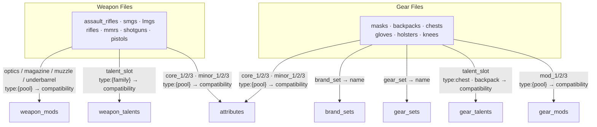

# Tom Clancy's The Division 2 — Weapon & Gear Analysis

Analyzes in-game weapons and gear to identify optimal loadouts. Raw game data is sourced
from the community-maintained [div2hub/game-data](https://github.com/div2hub/game-data)
repository and stored in the shared data lake for processing.

---

## Project Structure

```
td2/
├── fetch_div2hub.py                # Primary refresh script (weapons + gear + attributes)
├── fetch_weapons_div2hub.py        # Legacy weapons-only script (kept for reference)
├── loader.py                       # Loads Bronze CSVs into typed Python objects
├── models.py                       # Weapon, BrandSet, GearSet, Gear dataclasses + DPS
├── compare_weapons_local.py        # Ranks all weapons in a class by DPS metrics
├── compare_weapons_local_ar.py     # Legacy AR-only script (superseded by above)
├── optimize_brands_local_weapons.py # Brand + gear set optimizer for a weapon loadout
├── generate_weapon_dashboard.py    # Generates the self-contained HTML dashboard
├── dashboard_weapons.html          # Interactive weapon dashboard (open in any browser)
├── IDEAS.md                        # Planned and in-progress analyses
└── README.md
```

**Bronze layer** — `data-lake/01_Bronze/division_2/`  
**Silver layer** — `data-lake/02_Silver/division_2/`

---

## Analyses

### 1 — Weapon Comparison (`compare_weapons_local.py`)

Ranks all weapons in a class by three DPS metrics:

| Metric | Formula |
|--------|---------|
| Raw DPS | `base_damage × (base_rpm / 60)` |
| Sustained DPS | `(base_damage × mag_size) / (mag_duration + reload_time)` |
| Headshot DPS | `sustained_dps × (1 + hsd / 100)` |

Exotic placeholder rows (no base stats) are excluded. Talents are excluded from scoring — they are re-rolled via tinkering and should be chosen separately.

```bash
# Usage
C:/Users/peter.rigali/Desktop/acn_repo/.venv/Scripts/python.exe td2/compare_weapons_local.py <weapon_class> [sort_by]

# weapon_class: assault_rifles | smgs | lmgs | rifles | mmrs | shotguns | pistols
# sort_by:      raw_dps | sustained_dps | headshot_dps  (default: headshot_dps)

# Examples
python td2/compare_weapons_local.py rifles
python td2/compare_weapons_local.py assault_rifles headshot_dps
```

Output saved to `data-lake/02_Silver/division_2/{YYYYMMDD}_local_weapons_{class}_ranked.csv`.

---

### 2 — Brand & Gear Set Optimizer (`optimize_brands_local_weapons.py`)

Given one or two weapon types, finds the best combination of brand sets and gear sets
across 6 gear slots to maximize weapon-relevant stat bonuses.

**Scoring priority** (configurable per weapon type):
1. Weapon damage (flat — benefits both weapons)
2. Headshot damage (strong for MMR / headshot builds)
3. Weapon-type-specific damage (e.g. `marksman-rifle-damage`, `shotgun-damage`)
4. Critical hit chance / damage (universal offensive)

**Slot-fill patterns supported:**

| Pattern | Description |
|---------|-------------|
| `3-3` | Two brands at 3pc each |
| `3-2-1` | Three brands at 3/2/1pc |
| `2-2-2` | Three brands at 2pc each |
| `2-2-1-1` | Four brands with optimal 2/1 assignment |
| `GS3+3` | One gear set at 3pc + one brand at 3pc |
| `GS3+2+1` | One gear set at 3pc + two brands at 2/1pc |
| `GS2+2+2` | One gear set at 2pc + two brands at 2pc each |
| `GS2+3+1` | One gear set at 2pc + one brand at 3pc + one at 1pc |

Gear sets are scored up to 3pc only — 4pc bonuses involve triggered special mechanics
that cannot be quantified numerically.

```bash
# Edit weapon_types list in __main__ block, then run:
C:/Users/peter.rigali/Desktop/acn_repo/.venv/Scripts/python.exe td2/optimize_brands_local_weapons.py
```

Output saved to `data-lake/02_Silver/division_2/{YYYYMMDD}_local_brands_{types}_optimized.csv`.

---

### 3 — Weapon Dashboard (`dashboard_weapons.html`)

Self-contained HTML file — open directly in any browser, no server required.

Features:
- **Class selector**: All, Assault Rifles, SMGs, Rifles, Shotguns, Snipers (MMR), LMGs
- **Multi-class view**: select multiple classes simultaneously; a Class column appears automatically
- **Rarity filter**: Normal / Named / Exotic toggles
- **Sort**: click any column header (HSD DPS, Sus DPS, Raw DPS, Damage, RPM, …)
- **Stat cards**: top weapon, peak HSD DPS, weapon count for the current selection
- **Bar chart**: inline HSD DPS bar scaled to the current selection's maximum

Regenerate after a data refresh:

```bash
C:/Users/peter.rigali/Desktop/acn_repo/.venv/Scripts/python.exe td2/generate_weapon_dashboard.py
```

---

## Data Sources

All CSVs are pulled from `https://github.com/div2hub/game-data`.

| Category    | Files | Description |
|-------------|-------|-------------|
| Attributes  | `attributes.csv` | Stat IDs, ranges, and compatibility for all core/minor attributes |
| Weapons     | `assault_rifles`, `smgs`, `lmgs`, `rifles`, `mmrs`, `shotguns`, `pistols`, `weapon_talents` | Base stats and talent slots per weapon |
| Gear (slots) | `masks`, `backpacks`, `chests`, `gloves`, `holsters`, `knees` | Slot-level item data including named and exotic pieces |
| Gear (meta) | `brand_sets`, `gear_sets`, `gear_talents`, `gear_mods` | Brand/set bonuses, talent descriptions, and mod stat ranges |

---

## Bronze Layer Files

Files follow the repo's universal naming convention:
`{YYYYMMDD}_ext_{category}_{type}.csv`

| File | Rows (approx.) | Notes |
|------|---------------|-------|
| `{date}_ext_attributes_all.csv` | 83 | All attribute stat IDs with min/max ranges |
| `{date}_ext_weapons_assault_rifles.csv` | — | AR base stats |
| `{date}_ext_weapons_smgs.csv` | — | SMG base stats |
| `{date}_ext_weapons_lmgs.csv` | — | LMG base stats |
| `{date}_ext_weapons_rifles.csv` | — | Rifle base stats |
| `{date}_ext_weapons_mmrs.csv` | — | Marksman rifle base stats |
| `{date}_ext_weapons_shotguns.csv` | — | Shotgun base stats |
| `{date}_ext_weapons_pistols.csv` | — | Pistol base stats |
| `{date}_ext_weapons_talents.csv` | — | Weapon talent descriptions |
| `{date}_ext_weapons_mods.csv` | ~240 | All weapon attachments with compatibility and stat bonuses |
| `{date}_ext_gear_masks.csv` | — | Mask items (brand, gear set, named, exotic) |
| `{date}_ext_gear_backpacks.csv` | — | Backpack items |
| `{date}_ext_gear_chests.csv` | — | Chest items |
| `{date}_ext_gear_gloves.csv` | — | Glove items |
| `{date}_ext_gear_holsters.csv` | — | Holster items |
| `{date}_ext_gear_knees.csv` | — | Kneepads items |
| `{date}_ext_gear_brand_sets.csv` | 38 | Brand set 1/2/3-piece bonuses |
| `{date}_ext_gear_gear_sets.csv` | 28 | Gear set 2/3/4-piece bonuses and set talents |
| `{date}_ext_gear_gear_talents.csv` | — | Chest and backpack talent descriptions |
| `{date}_ext_gear_gear_mods.csv` | 17 | Gear mod stat IDs and ranges |

Existing files are never overwritten — re-runs append a `_v2`, `_v3` suffix.

---

## Schema Linkage

### Slot value encoding

All slot columns use a shared three-value pattern:

| Pattern | Meaning |
|---|---|
| `type:{pool}` | Random roll — use `{pool}` as the key to find eligible options in the reference table |
| `fixed:{name}` | Locked value (named/exotic item) — `{name}` is the exact lookup key |
| `N/A` | Slot does not exist on this item |

### Weapons

Each weapon row links to three reference tables:

| Column(s) | Reference table | Join |
|---|---|---|
| `optics`, `magazine`, `muzzle`, `underbarrel` | `weapon_mods` | `type:{pool}` → rows where `{pool}` appears in `compatibility` (pipe-delimited); `fixed:{name}` → `weapon_mods.name` |
| `talent_slot` | `weapon_talents` | `type:{family}` → rows where `{family}` appears in `compatibility`; `fixed:{name}` → `weapon_talents.name` |
| `core_1/2/3`, `minor_1/2/3` | `attributes` | `type:{pool}` → rows where `{pool}` appears in `compatibility`; `fixed:{stat_id}` → `attributes.stat_id` |

### Gear

Each gear row links to five reference tables:

| Column(s) | Reference table | Join |
|---|---|---|
| `brand_set` | `brand_sets` | Direct name match → `brand_sets.name` |
| `gear_set` | `gear_sets` | Direct name match → `gear_sets.name` (empty if not a set piece) |
| `talent_slot` | `gear_talents` | `type:chest` / `type:backpack` → rows where slot type appears in `compatibility`; `fixed:{name}` → `gear_talents.name` |
| `mod_1`, `mod_2`, `mod_3` | `gear_mods` | `type:{pool}` → rows where `{pool}` appears in `compatibility` (pipe-delimited) |
| `core_1/2/3`, `minor_1/2/3` | `attributes` | `type:{pool}` → rows where `{pool}` appears in `compatibility`; `fixed:{stat_id}` → `attributes.stat_id` |

### Diagram



---

## Refreshing Data

Run the unified fetch script whenever the upstream source updates (e.g. after a Title Update):

```bash
C:/Users/peter.rigali/Desktop/acn_repo/.venv/Scripts/python.exe td2/fetch_div2hub.py
```

Fetches all 20 files, versions any conflicts, and writes a log to
`data-lake/00_Logs/division_2/fetch_div2hub_{YYYYMMDD}.log`.

After refreshing Bronze data, re-run the weapon comparisons and regenerate the dashboard:

```bash
# Re-rank all weapon classes
for cls in assault_rifles smgs rifles shotguns mmrs lmgs pistols; do
    python td2/compare_weapons_local.py $cls
done

# Regenerate dashboard
python td2/generate_weapon_dashboard.py
```

Full workflow details: [`agent/workflows/refresh-td2-data.md`](../agent/workflows/refresh-td2-data.md)
